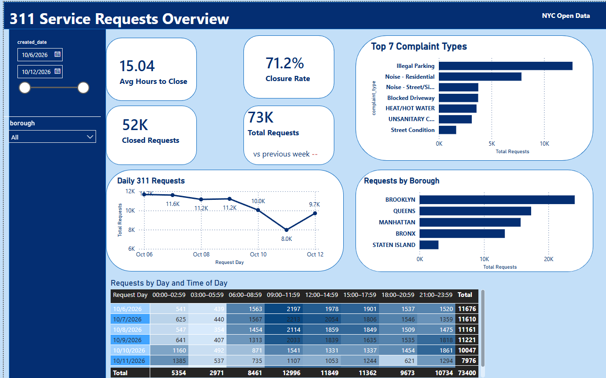

# NYC 311 Data Pipeline

This project collects NYC 311 service requests from the [NYC Open Data API](https://data.cityofnewyork.us/resource/erm2-nwe9.json), prepares them with Python, loads them into PostgreSQL, and uses SQL views for a Power BI report.

## How it works

1. `fetch_day.py` downloads all available requests for a date you provide.
2. `prepare_311.py` converts the API response to CSV.
3. `run_pipeline.sh` loads the CSV into a staging table and updates the main table.
4. SQL views calculate daily metrics and complaint counts by borough.

Requests are identified by `unique_key`, so running the pipeline again updates existing records instead of creating duplicates.

## Files

- `01_schema.sql` — creates the PostgreSQL tables.
- `02_upsert.sql` — inserts or updates requests from the staging table.
- `03_daily_metrics.sql` — daily request and closure metrics.
- `04_borough_complaints.sql` — request counts by borough and complaint type.
- `05_data_quality.sql` — checks missing fields and invalid close dates.
- `fetch_day.py` — downloads one day of data from the API.
- `prepare_311.py` — prepares the CSV file.
- `run_pipeline.sh` — runs the complete loading process.

## Run locally

Requires Python 3 and PostgreSQL. From the project directory:

```bash
sudo -u postgres createdb nyc_311
sudo -u postgres psql -d nyc_311 -f 01_schema.sql
bash run_pipeline.sh 2026-10-12
sudo -u postgres psql -d nyc_311 -f 03_daily_metrics.sql
sudo -u postgres psql -d nyc_311 -f 04_borough_complaints.sql
sudo -u postgres psql -d nyc_311 -f 05_data_quality.sql
```

Run `bash run_pipeline.sh YYYY-MM-DD` for each additional day.

## Reporting notes

## Power BI report

### Overview



### Hotspots


The SQL views currently report on October 6–12, 2026. Average time to close uses closed requests with a nonnegative difference between `closed_date` and `created_date`. It represents the recorded elapsed time; reassigned or reopened requests are not identified separately.

The pipeline runs for dates you provide. It is not a live feed.
